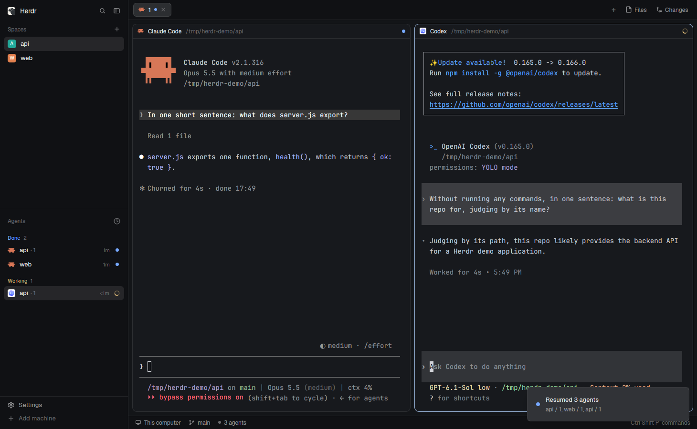
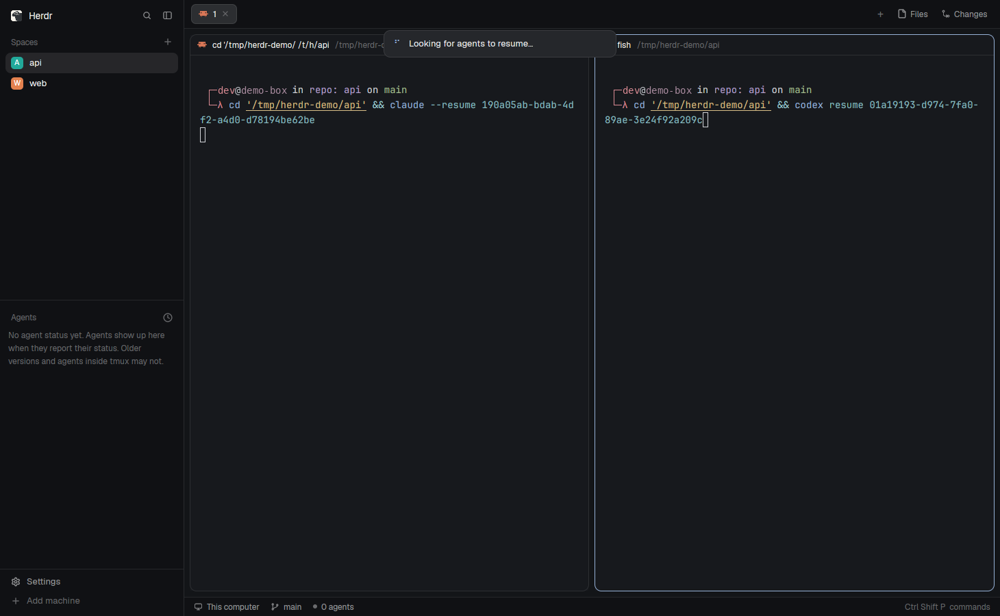

# herdr-agent-resume

**Bring Claude Code and Codex sessions back after a reboot, in the [Herdr](https://herdr.dev) desktop app.**

When the machine restarts (or you log out, or herdr-core restarts), Herdr brings every tab and split back, but each terminal comes back as a bare shell in its last folder: the agent that was running there is gone. The Herdr TUI used to resume agents on restore. The app doesn't, by design ([herdr-core#13](https://github.com/herdrdev/herdr-core/issues/13)).

This mod brings that back. Press **Ctrl+Shift+R** after a restart, and each terminal that lost its agent gets the command to resume it, typed into its shell:

| Was running | Typed into the restored shell |
|---|---|
| Claude Code | `cd '<folder>' && claude --resume <session>` |
| Codex | `cd '<folder>' && codex resume <session>` |

The agents open idle on their old conversation; nothing runs until you type. A toast says what came back.

Or skip the key press: install with `--auto` and each restored terminal starts its agent again by itself, as soon as its shell is up (fish, bash, zsh). See [Automatic resume](#automatic-resume).



Right after the key press, while the commands are typed into the restored shells:



(Real screenshots of a demo Herdr window, taken with `herdr-app shot`. The shell prompt's user name and the Claude plan were masked.)

## Install

```sh
git clone https://github.com/thuanlm215/herdr-agent-resume
python3 herdr-agent-resume/scripts/install.py
```

The installer:
- copies `mods/agent-resume/` to `~/.config/herdr-app/mods/` (after `herdr-app check`);
- binds Ctrl+Shift+R to `mod.open:agent-resume` in `keys.json`, refusing a key already in use;
- appends one `SessionStart` hook to `~/.claude/settings.json` and `~/.codex/hooks.json`, after the hooks already there, backing both files up to `~/.config/herdr-app/backups/agent-resume/` first;
- notes the Claude Code sessions already running in Herdr, so they're covered right away.

Then:
- **Codex** asks you to review the new hook the next time it starts ("Hooks need review"): trust it, or Codex sessions won't be noted.
- Codex sessions already running are noted the next time they start or resume.

Update with `--update`, remove everything with `--uninstall`. `--dry-run` shows what would change.

### Automatic resume

```sh
python3 herdr-agent-resume/scripts/install.py --auto      # or --update --auto
```

`--auto` adds a few marked lines to your shell's startup, for each shell set up on this machine:
- **fish:** a file of its own, `~/.config/fish/conf.d/agent-resume.fish`;
- **bash:** a block at the end of `~/.bashrc`;
- **zsh:** a block at the end of `~/.zshrc` (or `$ZDOTDIR/.zshrc`).

Each file is backed up first. At its first prompt, an interactive shell in a Herdr terminal runs `agent_resume.py here`. When that terminal lost its agent, it starts the agent again, in the session's folder: `claude --resume <id>` or `codex resume <id>`. It types nothing, so nothing lands in your shell history. Every other shell (a new tab, a nested shell, a terminal that didn't lose anything) carries on as usual, after one quick `hc get`.

Set `AGENT_RESUME_AUTO=0` to pause it for a while. `--no-auto` (with `--update`) takes the lines out again; `--uninstall` does too. Ctrl+Shift+R keeps working for terminals that weren't at a shell, and stays quiet about the ones their shell already brought back.

No layout change is needed. Linux and macOS, Python 3.8+ (standard library only).

## How it works

Three small pieces, all in `mods/agent-resume/agent_resume.py`:

1. **A SessionStart hook** (`hook claude|codex`). Every time an agent starts a session in a Herdr terminal (start, `/resume`, `/clear`, compact), it writes the session on that terminal as an `agent-resume` label in herdr-core: agent, session id, folder, transcript, the agent's process and the terminal's shell process, and the boot. Labels live with the terminal and survive a reboot.
2. **A watcher** (`watch`, started by the hook, one per agent process). It sleeps until the agent exits. If the terminal's shell is still the same process afterwards, you quit the agent yourself, so it removes the label: a session you quit stays quit. If the shell went with it (reboot, logout, core restart, pane closed), the label stays.
3. **The resume pass** (`resume`, what Ctrl+Shift+R runs; with `--auto`, each restored shell runs `here` for itself instead). A terminal needs its agent back when its label is from another boot, or its shell is a different process than the one the agent ran under. Then, if it sits at an idle shell, the pass types the resume command into it (`hc send`), 150 ms apart. It waits up to 12 s for restored shells that haven't started yet.

It skips, and says why:
- a terminal running something else;
- a session already open in another terminal (or resumed once already in this pass);
- a folder that's gone, or one whose name can't be typed safely (a quote, a backslash, a control character);
- a session with no saved conversation (an agent you never typed into).

It also never notes:
- subagents and Codex sub-threads;
- an agent started by another agent (a `claude -p` from a tool);
- an agent running inside tmux, ssh or anything else between it and the Herdr terminal.

`python3 ~/.config/herdr-app/mods/agent-resume/agent_resume.py status` shows what a pass would do, without typing anything. What the hook, watcher and passes did is logged to `~/.config/herdr-app/data/agent-resume/log.jsonl`.

## Watch out

- **Why `cd` first:** `claude --resume <id>` finds a session only from its project folder, and Codex works where it starts. The restored shell opens in the terminal's last folder, which can differ from the session's (the agent moved into a worktree, or the terminal started elsewhere).
- **You press the key, unless you install with `--auto`.** Herdr's shipped layouts run no mod in the background, so the mod can't do anything by itself after a restart. Press Ctrl+Shift+R once Herdr is open, or let the shell start the agent itself with `--auto`.
- With Ctrl+Shift+R, the resume command is typed into your shell, so it lands in your shell history. `--auto` doesn't type anything.
- A folder Claude Code hasn't been told to trust stops at its trust prompt. Folders you worked in are trusted already.
- `claude --resume` may continue under a new session id. The hook follows it, since every start is noted.
- Supported agents: Claude Code and Codex. Shells: fish, bash, zsh, sh, dash, ksh (`--auto`: fish, bash, zsh).
- Codex notes a session at its first message, not when it opens.
- Like the Herdr TUI's resume, this relies on how each agent CLI resumes today. If a CLI changes its flags or its hook input, it can break.

The full spec (what you see, how it behaves, how it's built) is in [RECIPE.md](RECIPE.md).

## Development

How to report a problem, try a change safely and open a pull request: [CONTRIBUTING.md](CONTRIBUTING.md). On macOS? A "Tried it on my machine" issue helps even when everything works.

```sh
python3 -m unittest discover -s tests -p 'test_*.py'   # plan, process tree, hook guards, installer
node --test tests/*.test.mjs                           # the toast text
herdr-app check mods/agent-resume
```

`agent_resume.py` keeps the decisions in pure functions (`plan`, `decide_here`, `lost`, `at_shell`, `command`, `placement`) so they can be tested without herdr-core. `main.js` is the popup: it runs one pass with `exec` and posts the toast built by `summary.js`.

Checked in a running Herdr app: with two Claude Code sessions and a Codex session open, `hc server stop` then `hc server start`, then Ctrl+Shift+R: all three came back on their conversations and the hooks noted them again.

`--auto` was checked the same way: fish and bash terminals with stand-in agents, a core stop and start, and each restored shell started its agent on its own session and folder; Ctrl+Shift+R afterwards found nothing to do, and quitting a resumed agent forgot its session. The zsh lines haven't run in a real zsh yet.

Also validated end to end against an isolated herdr-core session (`HC_SESSION=…`, its own app home): stand-in `claude`/`codex` programs that run the hook like the real ones, a core stop and start, then a pass. Covered: a resumed Claude and Codex session, a quit Codex session not coming back, a busy terminal skipped then resumed, a nested agent not noted. The real Claude Code 2.1.316 hook was checked the same way (noted on start, forgotten on `/exit`). Herdr app 0.1.10, herdr-core 0.1.15, Linux.

## Credits

The resume commands follow the Herdr TUI's table ([`src/agent_resume.rs`](https://github.com/herdrdev/herdr/blob/main/src/agent_resume.rs)). The popup follows [herdr-reopen-tab](https://github.com/mustafaTokmak/herdr-reopen-tab).

## License

MIT
