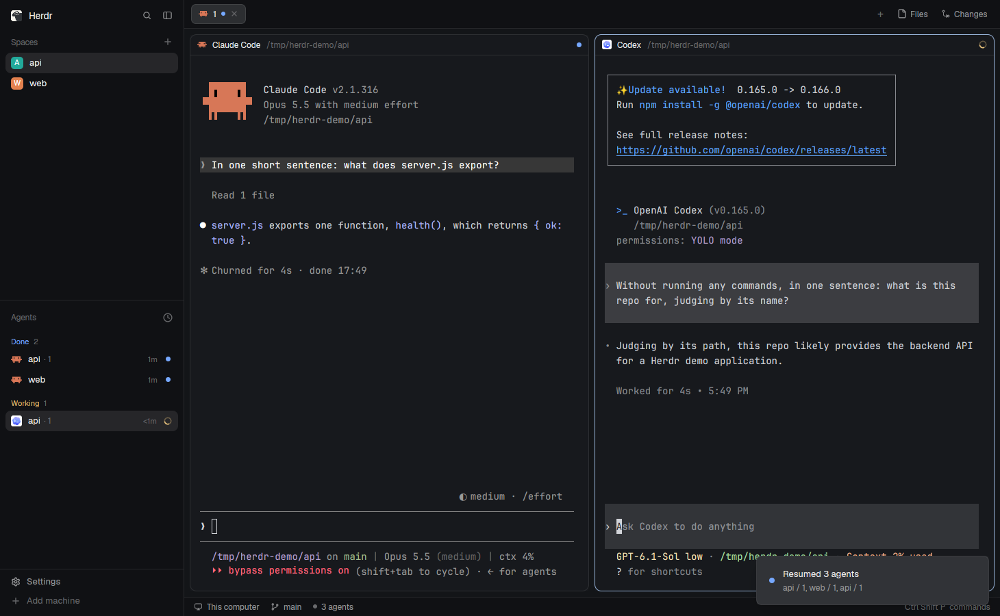

# Agent resume

Restarting the machine kills every agent. Herdr brings each terminal back as a bare shell in its last folder, but it never runs the program again, so Claude Code and Codex chats are gone from their panes. This mod brings them back: a small SessionStart hook notes which session runs in which terminal, and Ctrl+Shift+R types `claude --resume <id>` or `codex resume <id>` into each terminal that lost its agent and sits at a shell. A toast says what came back.



(A real screenshot of a demo Herdr window after a core restart and Ctrl+Shift+R: Claude Code and Codex back on their conversations, the toast at the bottom right. The Claude plan was masked. The mod itself shows only the short popup and the toast.)

## What you see

- Nothing until you press Ctrl+Shift+R.
- Then a popup pill, 340×40 px, centered at the top of the window 44 px down: the theme's `popover` background, a 1 px `border` outline, 10 px corners, 14 px side padding. Inside, 10 px apart: a 12 px braille spinner (`⠋⠙⠹⠸⠼⠴⠦⠧⠇⠏`, 80 ms a frame) in `accent`, and 13 px `foreground` text, "Looking for agents to resume…", truncated with an ellipsis. It closes by itself when the pass ends, usually within a second.
- In each terminal that gets its agent back, the shell shows the typed command, `cd '<folder>' && claude --resume <id>` (or `codex resume <id>`), and the agent opens on its old conversation, idle.
- Then a toast, one line of body:
  - success, "Resumed 3 agents", body the terminals' `space / tab`, 5 s;
  - warning, "Resumed 2 of 3 agents", body "Not resumed: web / 2: something else is running there", 8 s;
  - warning, "Couldn't resume 1 agent", body the reasons, 8 s;
  - info, "No agent to resume", body "No terminal lost its agent.", 3 s;
  - info, "Already resuming agents" for a second press while a pass runs;
  - error, "Couldn't resume agents" with the error.

## How it behaves

- **Noting sessions.** A SessionStart hook for Claude Code and Codex runs `agent_resume.py hook claude|codex`. Inside a Herdr terminal (`HC_TERMINAL_ID` set), it sets the label `agent-resume` on that terminal to compact JSON: `agent`, `session`, `cwd`, `transcript`, `pid` (the agent), `shell` (the terminal's program), `boot` (Linux `boot_id`, macOS `kern.boottime`) and `at`.
  - Claude Code runs it on start, `/resume`, `/clear` and compact.
  - Codex runs it at the first turn of a session, not when it opens, so a Codex window nobody typed into isn't noted. There's nothing to resume in it anyway.
- It doesn't note:
  - Claude subagents (`agent_id` in the hook input);
  - Codex sub-threads (`CODEX_THREAD_ID` differs from the session);
  - sessions without a transcript;
  - an agent with another agent between it and the terminal's program (a `claude -p` run by an agent's tool);
  - an agent the terminal's program isn't above at all (tmux, ssh).
- **Forgetting quit sessions.** The hook starts a detached watcher per agent process (`agent_resume.py watch`, a per-pid lock keeps it to one). It waits for the agent to exit (`pidfd` on Linux, else a 2 s poll), waits 2 s more, and if the terminal's program is still the same live process, removes the label: the person quit the agent. If that program died too (reboot, logout, core stop, pane closed), the label stays. A core stop also stops the watchers with the terminals.
- **A pass** (Ctrl+Shift+R, or `agent_resume.py resume`):
  - reads every live local terminal (`hc ls`, then `hc get` 8 at a time);
  - a labeled terminal lost its agent when its label is from another boot, or its program isn't the process the agent ran under;
  - resumes, newest first, each lost one whose foreground is the terminal's own shell (fish, bash, zsh, sh, dash, ksh), typing the command with `hc send` 150 ms apart, after the shell has run at least 1.5 s;
  - waits up to 12 s, re-reading every 0.5 s, for restored shells that haven't started yet;
  - skips, with the reason in the toast: something else running there; its folder gone; its folder name not typable (a quote, a backslash, a control character); no saved conversation (the transcript doesn't exist); a session still open in another terminal or resumed once already in this pass (those two aren't shown).
- After a resumed agent starts, its hook notes it again with the new shell, so a second press does nothing.
- Only one pass runs at a time; a second press reports "Already resuming agents".

## Built from

- `mods/agent-resume/mod.json`: `{"place": "none", "title": "Agent resume", "overlay": {"kind": "popup", "at": "top", "offset": 44, "width": 340, "height": 40, "frame": "none"}}`. Not a pane or a layout block: `mod.open:agent-resume` opens it as that popup.
- `keys.json`: `{"global": {"ctrl-shift-r": "mod.open:agent-resume"}}`.
- `main.js`: the popup view. `init` runs `exec("python3", [appHome() + "/mods/agent-resume/agent_resume.py", "resume"])` in `cx.spawn`, parses the JSON, posts `notify(summary(out))` and always ends with `closeOverlay(props().overlay)`. `render` is an `h_flex` with a `div().frames(SPIN, 80)` spinner and a `truncate()` label. Herdr functions: `exec`, `appHome`, `theme`, `props`, `closeOverlay`, `notify`.
- `summary.js`: the toast text, no `herdr` imports.
- `agent_resume.py`: Python 3.8+, standard library only. Commands `hook`, `watch`, `resume`, `status` (a dry run), `adopt` (notes running Claude Code sessions from `~/.claude/sessions/<pid>.json`). It runs `hc` (`ls`, `get`, `label`, `send`), reads `/proc` (or `ps`, `sysctl`), and writes only `data/agent-resume/log.jsonl` (trimmed to 256 KiB) and lock files under `$XDG_RUNTIME_DIR`. It never reaches the network.
- **Installing also needs the hooks.** Append one group to `SessionStart` in `~/.claude/settings.json` and in `~/.codex/hooks.json`, after the existing ones (Codex trusts hooks by position), backing both files up first:

  ```json
  { "hooks": [{ "type": "command", "command": "python3 '/home/you/.config/herdr-app/mods/agent-resume/agent_resume.py' hook claude", "timeout": 10 }] }
  ```

  (`hook codex` in Codex's file.) `scripts/install.py` does all of it: copy, key, both hooks, `adopt`; `--update`, `--uninstall`, `--dry-run`.

## Watch out

- **Nothing runs by itself.** The shipped layouts run no mod in the background; the person presses Ctrl+Shift+R after Herdr opens.
- Codex shows "Hooks need review" the next time it starts after install. Until the person trusts the hook, Codex sessions aren't noted.
- `hc send` from inside a Herdr terminal wraps the text in `<hc from="tN">…</hc>` for agents. The pass drops `HC_TERMINAL_ID` and `HC_SCOPE` for its sends, so they're plain even when run from a terminal.
- The `cd` matters. `claude --resume <id>` finds a session only from its project folder, and Codex works in whatever folder it's started in. A restored shell starts in the terminal's last folder, which isn't always the session's: the agent may have moved into a worktree, or the terminal was started elsewhere.
- Session ids are checked against `^[A-Za-z0-9][A-Za-z0-9-]{7,127}$` before they're typed; folders go between single quotes.
- The hook must never get in the agent's way: it prints nothing, gives `hc` 3 s, and swallows every error into the log.
- `claude --resume` may continue under a new id; the hook follows it.
- A folder Claude Code hasn't been told to trust stops at its trust prompt.
- Labels live in herdr-core with the terminal, so removing a terminal (`hc rm`) or closing its pane forgets the session too.
- Tested on Linux only (Herdr app 0.1.10, herdr-core 0.1.15, Claude Code 2.1.316, Codex 0.165.0, fish 4). The macOS code paths (`ps`, `sysctl`, polling instead of `pidfd`) haven't run.

## Done when

- `herdr-app check mods/agent-resume` passes, `npm test` passes (Python and node tests), `herdr-app status` shows `errors: []`.
- Starting `claude` in a Herdr terminal sets its `agent-resume` label; `/exit` removes it about 2 s later.
- A Codex session's label appears after its first message.
- `hc server stop`, then `hc server start` (run outside Herdr): each terminal comes back as a shell; Ctrl+Shift+R types the resume commands, the agents open on their conversations, and the toast reads "Resumed N agents". Pressing again says "No agent to resume".
- A session quit before the stop doesn't come back. A terminal running something else is skipped with that reason, and resumed on the next press once it's free.
